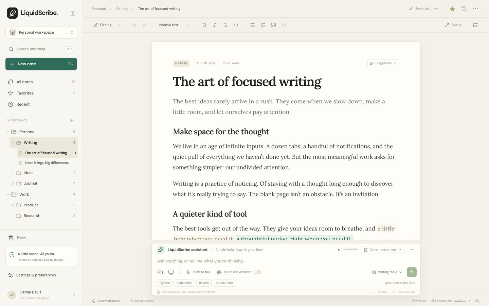
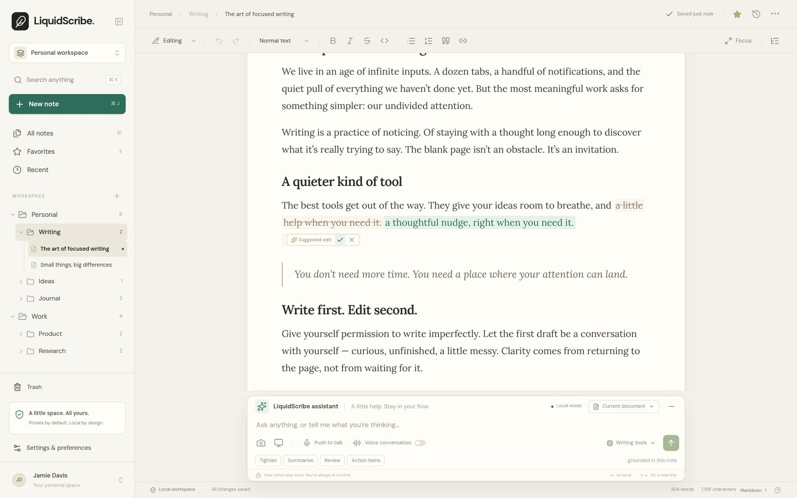
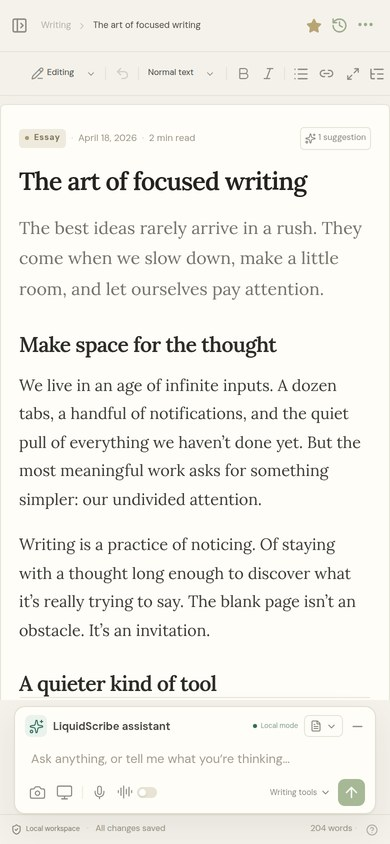

# LiquidScribe

A local-first writing workspace for Markdown notes, with an assistant that
proposes changes **inside the sentence** instead of taking over the page.



<p align="center"></p>

## What it is

A complete note-taking app — folders, search, version history, export, printing
— where the AI part is deliberately small and reversible:

- **Inline suggestions.** The worker inserts an `<ai-suggestion>` node with the
  original and replacement text; you accept or reject it exactly where it sits.
  Nothing is rewritten in bulk.
- **Built-in writing tools.** Tighten, summarise, expand, remove, explain and
  word-count work with no model at all, so the app is useful on a fresh clone.
- **Local model, optionally.** Point it at Ollama (`OLLAMA_BASE_URL`) and the
  same actions run through your own model. Nothing is sent anywhere else.
- **Visual + voice input.** Camera or screen capture attaches to a message;
  voice uses the browser speech service and never leaves the tab.

## Stack

| Layer | Choice |
| --- | --- |
| Framework | Next.js 16 (App Router, React 19) |
| Editor | Tiptap 3 + `tiptap-markdown`, custom suggestion node |
| Data | Postgres via Drizzle ORM (`notes`, `folders`) |
| Styling | Tailwind v4 entry point + hand-written CSS layers |
| Assistant | `/api/assistant` → built-in tools or an Ollama endpoint |

## Run it

```bash
# 1. a database (any Postgres will do)
docker run -d --name liquidscribe-db \
  -e POSTGRES_PASSWORD=scribe -e POSTGRES_DB=liquidscribe \
  -p 5433:5432 postgres:15-alpine

# 2. app
cp .env.example .env.local      # then edit if your DB differs
npm install
npx drizzle-kit push
npm run dev                     # http://localhost:3000
```

Optional local model:

```bash
ollama serve
ollama pull llama3.2            # or set OLLAMA_MODEL to something you have
```

The app checks `GET /api/assistant` at boot and shows the model in the
composer once it answers. Without it, the built-in tools stay available and the
badge reads "Writing tools".

## Environment

| Variable | Default | Purpose |
| --- | --- | --- |
| `DATABASE_URL` | — (required) | Postgres connection string |
| `OLLAMA_BASE_URL` | `http://127.0.0.1:11434` | Local model server |
| `OLLAMA_MODEL` | `llama3.2` | Preferred model name |

## Design

The current surface is the "paper" direction: warm desk (`#f3f1ea`), a physical
page (`#fffdf7`) with a hairline border and a soft shadow, one deep green accent
(`#2f6d5a`), Lora for prose and DM Sans for chrome. The assistant dock sits
*under* the page rather than floating over it, and the only saturated colour on
screen is the send button and a pending suggestion.

Two earlier explorations — a margin review queue and a dark command-palette
variant — live in the exploration notes, not in this build; the paper direction
won because the note has to stay put while a change is proposed.

## Status

Working app: notes CRUD, folders, search, trash, version history, Markdown
source mode, export (`.md` / workspace `.json`), print, focus mode, outline,
voice input, camera capture, inline suggestions with accept/reject/undo.

Verified on this commit: `npm run build` succeeds, `npx tsc --noEmit` is clean,
`npx eslint .` reports **0 errors** (13 warnings, all the "latest callback in a
ref" idiom the scaffold uses — those two rules are set to `warn` in
`eslint.config.mjs` with a note). `npm run smoke` drives the main flows with
Playwright against a running server.

Fonts: DM Sans and Lora are bundled under the SIL Open Font License (see
`public/fonts/*.txt`).

## License

MIT. See [LICENSE](LICENSE).

The initial scaffold came from a design brief; the paper theme, inline
suggestion review, quick actions and this README were built on top of it.
