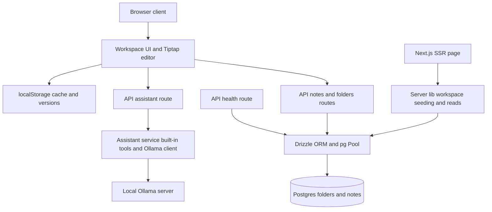

# LiquidScribe — Comprehensive Repository Audit

- **Audit date:** 2026-11-08
- **Audited commit:** `dac80d3abb41e7a26e6c61bed9d53251ef5d7f20` (`dac80d3` — "Render the editor on first paint, not after a remount"), branch `main`
- **Repository:** https://github.com/Theblackcat98/liquidscribe (public)
- **Local checkout audited:** `/home/hatch/workspace/liquidscribe`
- **Stack:** Next.js 16 App Router + React 19, Tiptap 3 + `tiptap-markdown`, Postgres via Drizzle ORM, Tailwind v4 + custom CSS
- **Method:** Three section auditors (UI/editor/client state, API/server/data/assistant, QA/build/docs) produced 61 raw findings (LSUI 21, LSAPI 24, LSQA 16), consolidated here by root cause into 50 items (TD-1–TD-50). The orchestrator independently spot-checked the Critical (LSAPI-01, zero auth) and it holds. Toolchain checks were actually executed on 2026-11-08; runtime behaviour against live Postgres/Ollama could not be executed in the audit VM and is labelled accordingly throughout. No application code was modified by this audit.
- **Raw severity totals (must match findings files):** LSUI — 0 Critical, 4 High, 8 Medium, 9 Low (21). LSAPI — 1 Critical, 3 High, 11 Medium, 9 Low (24). LSQA — 0 Critical, 3 High, 6 Medium, 7 Low (16). Combined — 1 Critical, 10 High, 25 Medium, 25 Low (61).

---

## 1. Executive Summary

LiquidScribe is a local-first Markdown note workspace: SSR-seeded notes and folders in Postgres, a Tiptap rich-text editor with Markdown source mode, inline reviewable AI suggestions (`<ai-suggestion>` atoms), a built-in no-model writing-tools fallback plus an optional local Ollama model path, browser voice and camera/screen capture, and localStorage-backed offline cache and version history. The README's core claim — that this is a working end-to-end app rather than a mock — is **true**. Almost every README Status feature traces UI → React state → `fetch` → API route → Drizzle → Postgres (or to the assistant service) with no placeholder in between. That is the unusual strength of this codebase and it should not be lost in the findings below.

The app is **not safe to expose beyond loopback, not safe for multi-tab/multi-client use without data-loss risk, and not yet reproducible from a clean clone without undocumented preconditions.** One Critical and a cluster of High findings dominate:

- **Critical — no authentication at all (LSAPI-01).** Every API route is open to anyone who can reach the server. LAN use is a designed-in scenario (`next.config.ts` allows a LAN dev origin), so this is reachable in practice, not theoretical. Simple-request CSRF / DNS-rebinding against a localhost instance can also trigger `POST` mutations from a hostile web page.
- **High — client-state divergence.** The localStorage cache unconditionally overrides fresh SSR data with no `updatedAt` reconciliation, and the PATCH endpoint is an upsert, so a permanently deleted note can silently resurrect (LSUI-1 / LSAPI-12). Overlapping debounced autosave PATCHes can land out of order and regress Postgres while the UI shows "Saved just now" (LSUI-2).
- **High — broken creation contract.** The real client creates notes only via the PATCH upsert; the validated `POST /api/notes` is dead code, PATCH's 404 is unreachable, and PATCH skips folder validation (LSAPI-02 / LSAPI-16).
- **High — fresh-clone setup trap.** `drizzle.config.json` hardcodes a database URL with password and ignores `DATABASE_URL`, so `drizzle-kit push` can create tables in the wrong database (LSAPI-03 / LSQA-07). There are no migrations (LSAPI-05 / LSQA-09).
- **High — flagship tool corrupts prose in one case.** The built-in Tighten/Rewrite tool, on already-concise text, returns an explanatory chat sentence flagged `edit: true`; accepting it replaces the user's prose with UI copy (LSAPI-04). Two sibling defects compound it: an empty Ollama response is returned as an editable deletion (LSAPI-06), and suggestion accept/reject irreversibly flattens formatting and paragraph structure (LSUI-4).
- **High — verification story is broken as documented.** `npm run build` fails without `DATABASE_URL` set (LSQA-01 / LSAPI-15); `npm run smoke` does not exist as an npm script (LSQA-02); the smoke suite itself could not be executed in the audit environment and is wired into no CI (LSQA-03, LSQA-05). There are zero unit tests (LSQA-04).

**What is already solid — do not "fix" these:**

- **No SQL injection.** All queries use Drizzle parameterised builders; the only raw `sql` templates are a static `select 1` and a fixed-column `orderBy` (LSAPI Checked-and-OK).
- **README's no-exfiltration claim verified for server code.** The only outbound server fetches are to the configured Ollama endpoint (`/api/tags`, `/api/chat`). No telemetry, no third-party calls (LSAPI Checked-and-OK, grep-verified over all `fetch(` sites).
- **No XSS sink in the rendering path.** Zero `dangerouslySetInnerHTML` / `innerHTML` / `eval` in `src/`; chat, suggestions, titles, and snippets render as escaped React text children (LSUI Checked-and-OK).
- **Typecheck and lint genuinely clean.** `tsc --noEmit` passes with `strict: true`; ESLint passes with 0 errors / 13 warnings, reproducing the README count exactly (LSQA, verified by run 2026-11-08).
- **Suggestion serialisation escaping is correct** (probe-verified round-trip for quotes, angle brackets, ampersands, newlines, and replacement-pattern traps), **link creation is scheme-restricted twice**, **modal focus-trap fundamentals are solid**, **capture stream cleanup is correct**, and **seeding is transactional and concurrency-safe** (see §6 and the findings files' Checked-and-OK lists).

**Suitability verdict (preview of §14):** suitable today for single-user, loopback-only personal use on a trusted machine, with the Tighten-on-tight-text and multi-tab caveats understood. Not suitable for LAN/multi-user exposure, not suitable as the sole copy of irreplaceable notes without an external backup habit, and not yet suitable for contributors — the build/smoke/CI path does not work as documented.

**Top next steps (see §13 for the ordered roadmap):** (1) enforce and document the loopback trust boundary or add a per-install token; (2) fix the save pipeline — serialise per-note saves, add revision/CAS to PATCH, reconcile boot cache by `updatedAt`; (3) split PATCH into true-update + POST-create and validate `folderId` on the real path; (4) make `drizzle.config` env-driven, commit migrations, make the DB pool lazy so build/health work without `DATABASE_URL`; (5) fix the Tighten meta-message and empty-response-as-deletion, and make the smoke suite runnable (npm script + harness + CI).

---

## 2. Repository Overview

| Item | Value (evidence) |
| --- | --- |
| Purpose | Local-first Markdown note workspace with paper theme and inline, reviewable AI suggestions (package.json description; README) |
| Repo / branch / commits | `Theblackcat98/liquidscribe`, `main`, 3 commits, all 2026-11-08: `67b4577` initial import (46 files), `2da3f83` package rename, `dac80d3` editor first-paint fix (LSQA-15) |
| GitHub issues / PRs | Zero open or closed issues/PRs at audit time |
| Tracked files | 46 (`git ls-files | wc -l`, LSQA verified) |
| Source size | ~2,264 LOC in `src/` (tasking figure); largest file `src/components/Workspace.tsx` at 334 lines; server assistant 91 lines; all API routes together ~123 lines |
| Runtime | Next.js 16.2.6 (App Router, `force-dynamic` SSR page), React 19.2.6, Node (audit VM: v24.22.1) |
| Editor | Tiptap 3.33.0 (`@tiptap/* ^3.33.0`) + `tiptap-markdown ^0.9.0` (pre-1.0, hand-written type shim) |
| Data | Postgres via `pg` 8.20.0 Pool + Drizzle ORM 0.45.2; two tables only (`folders`, `notes`); schema applied by manual `drizzle-kit push`, no migrations |
| Assistant | Built-in regex/heuristic tools (no model required) + optional Ollama (`/api/tags`, `/api/chat`, non-streaming, 90 s timeout); model honoured only if installed |
| Client persistence | localStorage: workspace cache (`liquidscribe:workspace:v1`), version snapshots (`liquidscribe:versions:<id>`, cap 20/note), preferences |
| Tests | One Playwright e2e script (`scripts/smoke.mjs`, 131 lines, 11 checks); no unit/integration/component tests; no test runner |
| CI / deployment | None: no `.github/`, no Dockerfile/compose (except a README Postgres snippet), no Vercel/other config |
| Licence | MIT (full text, Copyright (c) 2026 Nik); bundled fonts DM Sans + Lora with complete SIL OFL 1.1 texts |

**Intended use (inferred from README + code):** a single user's writing workspace on their own machine, optionally tested from a phone on the same LAN, with AI assistance kept local (built-in tools or a local Ollama model) and nothing sent to a cloud service. Every architectural judgement in this report is made against that intended use — the Critical finding is Critical precisely because the code does not enforce the loopback assumption the design depends on.

**What the app actually is today:** the intended app, substantially built. The gap is not missing features; it is (a) an unenforced trust boundary, (b) a save/cache layer that can silently diverge from Postgres, (c) setup/verification tooling that only works in the author's exact environment, and (d) a handful of correctness defects in the flagship suggestion flow and folder navigation.

---

## 3. Repository File Inventory and Audit Coverage

Total tracked files: **46**. Classification below follows LSQA's full inventory (verified by `git ls-files`, import tracing, and grep). No tracked source file other than `docs/before.jpg` was found orphaned.

| Category | Count | Files / notes | Audit treatment |
| --- | --- | --- | --- |
| Application source | 24 | `src/app/layout.tsx`, `page.tsx`, `globals.css` (523 lines), `theme-paper.css` (358 lines), `icon.svg`; API routes `api/notes/route.ts`, `api/notes/[id]/route.ts`, `api/folders/route.ts`, `api/assistant/route.ts`, `api/health/route.ts`; components `Workspace.tsx` (334), `Sidebar.tsx`, `DocumentEditor.tsx`, `EditorToolbar.tsx`, `AssistantDock.tsx`, `CapturePreview.tsx`, `Dialogs.tsx`, `SuggestionNode.tsx`, `useVoice.ts`; `src/db/index.ts`, `src/db/schema.ts`; `src/lib/workspace.ts`, `src/lib/server/workspace.ts`, `src/lib/server/assistant.ts` | Read in full by LSUI/LSAPI scopes; every file traced end-to-end |
| Tooling / scripts | 1 | `scripts/smoke.mjs` (131 lines, 11 Playwright checks) | Read in full (LSQA-03); execution attempted, blocked — see §7 |
| Configuration | 9 | `package.json`, `package-lock.json` (321,530 B), `tsconfig.json`, `eslint.config.mjs`, `next.config.ts`, `postcss.config.mjs`, `drizzle.config.json`, `.env.example`, `.gitignore` | Read in full; lockfile spot-checked (versions/integrity for next/playwright/lucide-react) |
| Documentation | 2 | `README.md` (101 lines), `LICENSE` (MIT, verified) | README reconciled claim-by-claim in §11 |
| Screenshots / docs assets | 4 | `docs/screenshot.jpg` (referenced), `docs/suggestion.jpg` (referenced), `docs/mobile.jpg` (referenced), `docs/before.jpg` (140,083 B, **orphaned — referenced nowhere**, LSQA-10) | Reference-checked by grep |
| Public assets — fonts | 5 | `public/fonts/dm-sans.ttf`, `lora.ttf`, `lora-italic.ttf` (all loaded via `@font-face`), `DM-Sans-OFL.txt`, `Lora-OFL.txt` (both complete SIL OFL 1.1) | Licence/reference verified; binary contents not reviewed |
| Type shim | 1 | `src/types/tiptap-markdown.d.ts` (4-line declaration for untyped `tiptap-markdown@0.9.0`) | Read (LSQA-11) |
| **Total** | **46** | 24 + 1 + 9 + 2 + 4 + 5 + 1 = 46 ✓ | |

**Coverage checklist:**

- Examined in detail: all `src/` TypeScript/TSX, all API routes, both server libs, DB schema/client, all config, README, smoke script, ESLint/TS configs.
- Executed: `npm ci`, typecheck, lint, build (with and without `DATABASE_URL`), `npm run smoke` (fails — missing script), `node scripts/smoke.mjs` (fails — browser/DB blockers), `npm audit` (blocked by proxy 403), `npm outdated`; isolated Node probes of pure functions (`cleanText`/`builtInTools`/response guard in LSAPI scratch; suggestion export/`plainText` round-trip and Sidebar `inFolder` filter in LSUI scratch).
- Excluded from detailed review (with reason): `package-lock.json` internals beyond spot-checks (generated); binary font/JPEG contents beyond size/licence/reference checks; `node_modules/` (not tracked).
- Generated files tracked: **none** — `.next/`, `node_modules/`, `next-env.d.ts` are gitignored and untracked (LSQA verified).
- Could not be inspected live: any behaviour requiring a running Postgres, a running Next server, a real browser session, or a live Ollama instance — none existed in the audit VM. Those behaviours are assessed by static tracing + probes and labelled Unverified where the distinction matters (notably the Ollama chat path and LSUI-12).
- TODO/FIXME/HACK/XXX/PLACEHOLDER markers in project code: **zero** (grep-verified by all three scopes). The debt in this repo is behavioural and structural, not annotated.

---

## 4. Architecture and System Design

### 4.1 Subsystems and data flow

The system is a small, legible monolith — deliberately so, and appropriately so for a single-user local app:

1. **SSR shell (`src/app/page.tsx`, `layout.tsx`).** `page.tsx` is `force-dynamic`; it calls `getWorkspace()` server-side and passes `initialNotes`/`initialFolders` as props. There is no catch: if Postgres is unreachable, `getWorkspace()` throws and the whole page 500s — the localStorage cache can never rescue the user because `Workspace` never mounts (LSUI cross-scope note). The "local-first / saved on device" story therefore has a hard server dependency at load time.
2. **Client workspace (`src/components/Workspace.tsx`, 334 lines).** The single state owner: notes/folders state, per-note debounce timers, `pending` save map, localStorage cache + version snapshots, dialogs, shortcuts, export/print, and the assistant dispatch (`runAction`). It is the app's centre of gravity — see §10 for the maintainability consequence.
3. **Editor (`DocumentEditor.tsx`, `SuggestionNode.tsx`, `EditorToolbar.tsx`).** Tiptap 3 with a custom inline atom node for `<ai-suggestion>`; content is stored as Markdown (via `tiptap-markdown`) and the suggestion markup round-trips through the stored Markdown string. Accept/reject replace the atom with plain text (see LSUI-4).
4. **Navigation/dialogs (`Sidebar.tsx`, `Dialogs.tsx`).** Folder tree, workspace switcher (Personal/Work roots), search dialog (client-side substring over the full in-memory workspace), settings, history, prompt dialogs. The `Modal` primitive is well built (focus trap, Escape, focus restoration).
5. **Assistant dock (`AssistantDock.tsx`, `useVoice.ts`, `CapturePreview.tsx`).** Chat UI with context modes (document/selection/none), model picker, quick-action chips, voice input (browser SpeechRecognition), and camera/screen capture producing a JPEG data URL attachment.
6. **API routes (`src/app/api/**`).** Thin handlers over Drizzle: notes collection GET/POST, note PATCH (upsert)/DELETE, folders POST only, assistant GET (runtime status)/POST, health GET (`select 1`). **No middleware, no auth, no origin/content-type checks anywhere** (LSAPI-01).
7. **Server libs (`src/lib/server/workspace.ts`, `assistant.ts`).** `ensureWorkspace()` (transactional, memoised, conflict-safe seeding of starter folders/notes) + `getWorkspace()` (ordered read). `assistant.ts`: built-in tools (regex Tighten, heuristic Summarise/Explain/Expand, Remove, broken ask-intents) and the Ollama client (status probe + non-streaming chat).
8. **Data (`src/db/index.ts`, `schema.ts`).** A `pg` Pool + Drizzle instance created at module import (throws if `DATABASE_URL` is unset — LSAPI-15/LSQA-01). Two tables: `folders` (id, name, `parentId` plain text with **no FK**, colour) and `notes` (id, title, content, `folderId` FK `onDelete: set null`, favourite, deleted, timestamps). No versions table, no revision column, no migrations.
9. **Client-only persistence.** localStorage holds the workspace cache, version history, and preferences. The workspace JSON export contains notes+folders only — no versions, and **no import/restore path exists anywhere** (backup is write-only).

### 4.2 Architecture diagram

*Reading note:* the diagram shows the intended shape. Two facts it cannot show: (a) there is no auth/origin gate on any API edge, and (b) at boot the `LocalStore` edge silently outranks the `PageSSR` edge (LSUI-1) — the cache replaces SSR props wholesale with no freshness comparison.

### 4.3 Architectural assessment

**Strengths.** Clear layering for its size; one seeding site with correct concurrency handling; error shapes on notes/folders routes are consistent and non-leaking (`{error: friendly string}`, no stacks/SQL); model selection is server-validated against the installed list (no arbitrary-model/endpoint injection); timeouts exist on both Ollama calls; the client→API field contract aligns at every `fetch(` call site (LSAPI contract map — the mismatches are semantic, not shape).

**Weaknesses.**

- **Trust boundary is assumed, not enforced.** No middleware, no binding restriction, no `Host`/`Origin`/`Content-Type` validation (LSAPI-01). The architecture has no place where auth could be added later without touching every route — a middleware seam should be created even if the policy stays "loopback only".
- **Two divergent read paths for the same data.** SSR `getWorkspace()` orders notes by `updatedAt desc` and folders by `createdAt`; `GET /api/notes` is unordered and also *mutates* (calls `ensureWorkspace()`) (LSAPI-18). The client never calls the GET — it exists for the smoke script — yet it is a full unauthenticated workspace dump.
- **Two divergent creation contracts.** Validated `POST /api/notes` (unused by the client) vs unvalidated PATCH upsert (the real path) (LSAPI-02/16). Validation effort sits on the dead path.
- **No concurrency primitive anywhere.** No revision, ETag, or `updatedAt` precondition on PATCH; unconditional last-write-wins compounded by a shadowing cache (LSAPI-12). Multi-tab use — ordinary use, not an edge case — can silently lose edits.
- **Import-time side effect couples build to runtime config.** `src/db/index.ts` throws at import when `DATABASE_URL` is unset, which aborts `next build` page-data collection and defeats `/api/health` itself (LSAPI-15/LSQA-01).
- **Pool lifecycle is production-inverted.** The global pool cache is only written when `NODE_ENV !== "production"`; no `max`/timeouts/`error` handler (LSAPI-15). Benign for one local instance; a connection-exhaustion risk in any multi-instance deployment.
- **Folders are a half-model.** `parentId` has no FK and is unvalidated; a dangling parent produces a folder that exists in API output but can never render in the sidebar (LSAPI-10). Notes' `folderId` FK *is* real — which is what makes the unvalidated PATCH path fail hard (LSAPI-09).
- **No circular dependencies or dead source files were found** (LSQA import tracing: every `src/` file is reachable). Complexity is concentrated, not tangled — `Workspace.tsx` is the single point of cognitive failure (see §10).

---

## 5. Complete Feature Inventory

Statuses use the audit taxonomy exactly: Working / Mostly working / Partial / Broken / Not implemented / Unverified / Deprecated. An auditor's *(unverified)* tag is never upgraded here. Evidence is `file:line` at commit `dac80d3`.

### 5.1 Notes & folders

| Feature | Description | Implementation | Status | Evidence | Limitations | Priority |
| --- | --- | --- | --- | --- | --- | --- |
| Notes CRUD | Create, edit, soft-delete, permanently delete notes | Create via client UUID + PATCH upsert; 650 ms debounced autosave; SSR-seeded from Postgres | Mostly working | `Workspace.tsx:102-122, 186-205, 244-255`; `page.tsx:8-14` | Cache overrides server (LSUI-1); out-of-order PATCH (LSUI-2); no save retry loop (LSUI-7) | Critical |
| Create note via POST /api/notes | Validated creation endpoint | Implemented with folder-exists check, 201 | Partial | `src/app/api/notes/route.ts:18-35` | Dead code for the real client (LSAPI-16); no content size cap (LSAPI-08) | Medium |
| Autosave via PATCH /api/notes/[id] | Persist edits | Insert-or-update upsert used for both create and update | Partial | `src/app/api/notes/[id]/route.ts:7-28` | Dead 404; no folder validation; unconditional last-write-wins (LSAPI-02/09/12) | Critical |
| Permanent delete (DELETE) | Irreversible delete | Correct hard delete with real 404 | Working | `src/app/api/notes/[id]/route.ts:31-40` | No auth (LSAPI-01); no trash-state precondition — any note hard-deletable directly | High |
| Load workspace | Full workspace for the UI | SSR `getWorkspace()` ordered; `GET /api/notes` unordered duplicate that also seeds | Mostly working | `page.tsx:7`; `src/lib/server/workspace.ts:27-34`; `src/app/api/notes/route.ts:8-15` | Two divergent read paths (LSAPI-18); client never calls the GET | Medium |
| Folders — create | Named, coloured, nestable folders | `POST /api/folders` (name required → 400, colour allowlist, name ≤60); nested tree with counts; move-note dialog | Partial | `src/app/api/folders/route.ts:4-19`; `Sidebar.tsx:30-46`; `Workspace.tsx:226-233` | Create-only everywhere (LSUI-11/LSAPI-10); see next two rows | High |
| Folders — rename / delete / read endpoints | Full folder lifecycle | No UI, no PATCH/DELETE folder routes; schema ready (`notes.folderId` FK `onDelete: set null`) | Not implemented | `src/app/api/folders/route.ts` (POST only); `src/db/schema.ts:15` | Misnamed folders are permanent; delete cascade can never trigger (LSAPI-10) | Medium |
| Folder tree rendering | Browse notes by folder | Recursive tree; a folder's own notes render **only if it is a leaf** | Partial | `Sidebar.tsx:34-41` | Notes filed directly in Personal/Work (both have children) are invisible in the tree (LSUI-5) | Medium |
| Move note to folder / Unfiled | Re-file a note | Move dialog offers `Unfiled` (`value=""`); submit handler supports `folderId: null` | Broken | `Dialogs.tsx:52`; `Workspace.tsx:331` | `PromptDialog` rejects empty values, so Unfiled can never be submitted (LSUI-6) | Medium |
| Work workspace All-Notes view | Workspace-scoped note list | Filter tests `note.folderId === "work"` or `inFolder(note.folderId)` | Broken | `Sidebar.tsx:22, 47` | `inFolder` compares folder ids to the active **note** id — always false; every subfolder note vanishes (LSUI-3, probe-verified) | High |
| Workspace seeding | Starter folders/notes on first run | Transactional, `onConflictDoNothing`, memoised promise, reset-on-failure | Mostly working | `src/lib/server/workspace.ts:8-25` | Keyed on "any folder exists"; only runs on two paths; partial states never heal (LSAPI-24) | Low |

### 5.2 Editor

| Feature | Description | Implementation | Status | Evidence | Limitations | Priority |
| --- | --- | --- | --- | --- | --- | --- |
| Rich-text editing (Tiptap) | Formatted writing surface | Tiptap 3 + StarterKit + Link (`rel="noopener noreferrer"`, `openOnClick: false`) + Placeholder + BubbleMenu; Markdown storage via `tiptap-markdown` | Mostly working | `DocumentEditor.tsx:50, 76-88, 112-130` | Parse-side Markdown round-trip not executed headlessly in this audit (no jsdom in repo); historical smoke asserts seeded suggestion rendering | High |
| Markdown source mode | Edit raw Markdown | Textarea bound to `note.content`, same autosave path; editor remounts on return | Mostly working | `Workspace.tsx:324` | Outline broken in source mode (LSUI-9); print prints the raw textarea (LSUI-18) | Medium |
| Formatting toolbar + undo/redo | Bold/italic/headings/lists/link, history | Toolbar wired to editor commands; Tiptap history | Working | `EditorToolbar.tsx:20` | Undo is the only recovery from suggestion flattening (LSUI-4) and does not survive reload | Medium |
| Link creation | Insert links safely | Scheme-restricted twice: dialog `validate` + submit handler require `https?://` or `mailto:` | Working | `Workspace.tsx:332`; `DocumentEditor.tsx:50` | — | Low |
| Outline | Jump by heading | H1–H3 list regex-scraped from raw Markdown; click scrolls by positional DOM index | Partial | `Workspace.tsx:95, 326` | Code-fence false positives; Setext missed; index mapping fragile; source-mode no-op (LSUI-9) | Medium |
| Preferences (font size, serif, width, word count display) | Personalisation | Settings dialog → CSS variables on the shell; persisted to localStorage | Working | `Dialogs.tsx:65-72`; `Workspace.tsx:182-184, 311` | — | Low |
| Keyboard shortcuts | ⌘K search, ⌘J new, ⌘S save, ⌘\ sidebar | Window keydown handler; ⌘K context-sensitively opens link dialog when a link is active | Mostly working | `Workspace.tsx:293-303` | Fire behind open modals; popovers have no Escape handling (LSUI-17) | Low |

### 5.3 Suggestions / AI assistant

| Feature | Description | Implementation | Status | Evidence | Limitations | Priority |
| --- | --- | --- | --- | --- | --- | --- |
| Inline suggestions — create | Assistant inserts a reviewable `<ai-suggestion>` | `runAction` captures selection, verifies doc text unchanged after the async call, inserts atom node; serialised into stored Markdown and re-parsed on load | Mostly working | `Workspace.tsx:245-283`; `DocumentEditor.tsx:76-88`; `SuggestionNode.tsx:58-64` | Insertion destroys the span's formatting/structure immediately (LSUI-4); parse round-trip historical (smoke), not re-run | Critical |
| Inline suggestions — accept/reject | Review in place | Node-view buttons replace the atom with replacement/original plain text; toast; count chip + jump-to-first | Mostly working | `SuggestionNode.tsx:6-26`; `Workspace.tsx:243, 322` | Restores flattened text, not original nodes (LSUI-4); controls may render in read-only contexts (LSUI-12, *unverified*) | Critical |
| Suggestion undo | Reversible via undo | Tiptap history restores the atom | Mostly working | `EditorToolbar.tsx:20`; `scripts/smoke.mjs` (accept→undo→reject→undo) | Evidence is the repo smoke script — historical, not re-run in this audit; history lost on reload | Medium |
| Multiple pending suggestions | Review several suggestions | Count is accurate (walks the doc); each individually resolvable | Partial | `DocumentEditor.tsx:36-40` | No bulk accept/reject UI; `resolveAll` is complete but dead code (LSUI-13); chip jumps to first only | Low |
| Suggestion serialisation / escaping | Persist suggestions in Markdown safely | Serializer escapes `&` first, then `" < >` and newline; export decodes with `&amp;` last | Working | `SuggestionNode.tsx:61`; `Workspace.tsx:30` | Probe-verified round-trip for serializer output; hand-authored unescaped markup corrupts (LSUI-15) | Medium |
| Assistant dock & quick actions | Chat + one-tap actions | Chat with context modes, model picker, abort support, insert-into-note for non-edit replies; 4 quick-action chips | Mostly working | `AssistantDock.tsx` (full); `Workspace.tsx:245-291` | "Review" and "Action items" chips have **no built-in implementation** — no-model users get the generic capability list (LSAPI contract map); busy actions silently dropped; selection mode with no selection sends empty context | High |
| Assistant runtime status (GET /api/assistant) | Report model availability | Probes Ollama `/api/tags` (1.5 s timeout); returns models/preferred/endpoint | Working | `src/app/api/assistant/route.ts:7-9`; `src/lib/server/assistant.ts:7-19` | Leaks endpoint URL + full model inventory unauthenticated (LSAPI-17) | Low |
| Built-in Tighten (`rewrite`) | Tighten prose with no model | Regex filler/phrase removal + fallback pass | Partial | `src/lib/server/assistant.ts:21-37, 59` | **Broken in one case:** already-concise text returns a meta-message flagged as an edit (LSAPI-04, probe P1); text corruptions (LSAPI-14) | High |
| Built-in Summarise (`summarize`) | 2-sentence summary ≤500 chars, non-editing | Implemented as specified | Mostly working | `src/lib/server/assistant.ts:39-42` | Sentence tokeniser breaks on abbreviations/decimals; mid-word truncation at 497 chars (LSAPI-19, probes P4/P12) | Low |
| Built-in Explain (`explain`) | Explain the passage | Word/sentence count + first sentence re-quoted + model upsell | Partial | `src/lib/server/assistant.ts:44-46` | Not an explanation; counts wrong on ordinary prose (LSAPI-19, probes P6/P12) | Low |
| Built-in Expand (`expand`) | Expand the passage | Appends one fixed generic paragraph to any input | Partial | `src/lib/server/assistant.ts:48-49` | Identical output for every input, including non-prose (LSAPI-19, probe P7) | Low |
| Built-in Remove (`remove`) | Propose removing the passage | Returns `""` with `edit: true` | Working | `src/lib/server/assistant.ts:51, 59` | Client supplies the review UI | Low |
| Built-in word count (via `ask`) | "Word-count works with no model" (README) | Intent regexes test the **document text**, not the user's instruction; counts the selection/empty field in selection/none modes | Broken | `src/lib/server/assistant.ts:53-54` | Effectively unreachable in the primary dock flow (LSAPI-07, probes P5/P5b). The separate status-bar count is client-side and works | Medium |
| Built-in title suggestions (via `ask`) | Suggest titles from the document | Three hardcoded titles claiming to be "inspired by your document's opening"; intent routing also broken | Broken | `src/lib/server/assistant.ts:55` | Titles are not derived from the document at all (LSAPI-07) | Medium |
| Built-in generic `ask` fallback | Graceful no-model fallback | Returns an honest capability list, `edit: false` | Working | `src/lib/server/assistant.ts:56` | Also the accidental destination for word-count/title asks (LSAPI-07) | Low |
| `ask` intent dispatch | Route free-text asks to tools | Regex dispatch on `instruction` for summarize/rewrite only | Mostly working | `src/lib/server/assistant.ts:69-70` | Word-count/title/expand/remove intents not dispatched (LSAPI-07) | Medium |
| Ollama chat path | Same actions via the user's local model | `/api/chat`, non-streaming, model validated against installed list, 90 s timeout, output-shape system prompt | Unverified | `src/lib/server/assistant.ts:73-90` | Plausible implementation; no live Ollama in audit scope. Empty response returned as editable deletion (LSAPI-06); per-call status probe + timeout race (LSAPI-21); prompt-injection note (LSAPI-20) | High |
| Ollama image understanding | Capture understood by a vision model | Base64 forwarded in the correct Ollama `images` field; friendly refusal when no model | Partial | `src/lib/server/assistant.ts:68, 80`; `src/app/api/assistant/route.ts:18-19` | No vision-capability check or format validation (LSAPI-22); no-model fallback silently rewrites action to `ask`. Runtime behaviour *unverified* | Medium |

### 5.4 Search / trash / history

| Feature | Description | Implementation | Status | Evidence | Limitations | Priority |
| --- | --- | --- | --- | --- | --- | --- |
| Search | Search across notes | `SearchDialog`: substring match over title + `plainText(content)` + folder name; favourites/recent filters; keyboard nav. No server search endpoint (by design at this scale) | Mostly working | `Dialogs.tsx:32-46` | Matches pending suggestions' **replacement** text (LSUI-15); no ARIA wiring for keyboard selection (LSUI-19); matching is `String.includes` — ReDoS-safe (Checked-and-OK) | Medium |
| Trash (soft delete / restore) | Deleted notes recoverable | `deleted` boolean round-tripped via PATCH; filtering client-side; restore from banner + menu; permanent delete with confirm modal; clears timers/pending/version storage | Mostly working | `Workspace.tsx:238-255, 316-317, 333`; `Sidebar.tsx:47, 58`; `src/db/schema.ts:17` | No server trash listing / empty-trash endpoint; suggestion controls in a trashed note *unverified* (LSUI-12); no "empty trash" bulk action | Medium |
| Version history | Restore earlier drafts | localStorage snapshots (on open / 60 s / before switch, assistant, restore; manual), cap 20, dedupe of unchanged head, preview + restore with pre-restore snapshot | Partial | `Workspace.tsx:140-148, 184-191, 285-288`; `Dialogs.tsx:84-88` | Browser-local only; **no server table/endpoint**; excluded from workspace export; quota failures silent (LSUI-21/LSAPI-11) | Medium |
| Health check (GET /api/health) | Liveness / DB check | `select 1` → `{ok:true}` / 500 `{ok:false}`, minimal disclosure | Mostly working | `src/app/api/health/route.ts:6-13` | Defeated by the import-time throw when `DATABASE_URL` is missing — returns a framework 500 instead of the JSON health shape (LSAPI-15) | Medium |

### 5.5 Export / print / modes

| Feature | Description | Implementation | Status | Evidence | Limitations | Priority |
| --- | --- | --- | --- | --- | --- | --- |
| Export note `.md` | Download note as Markdown | Blob download; pending suggestions exported as their **original** text via entity-decoding regex | Mostly working | `Workspace.tsx:29-31, 236` | Reads the stale render-scope note after flushing (LSUI-14); hand-authored unescaped markup corrupts (LSUI-15); filename unsanitised (cosmetic) | Medium |
| Export workspace `.json` | Backup whole workspace | Blob download of all notes (incl. trashed) + folders from `notesRef` | Mostly working | `Workspace.tsx:237` | **No import/restore path exists anywhere** — backup is write-only; versions excluded (LSUI-21) | High |
| Print | Print the document | `window.print()` + dedicated `@media print` stylesheet hiding chrome/toolbar/dock/controls | Mostly working | `Workspace.tsx:317`; `globals.css:523` | Source mode prints the raw textarea incl. `<ai-suggestion>` markup (LSUI-18); pending suggestions print replacement-only (deliberate-looking, undocumented) | Low |
| Focus mode | Distraction-free writing | Collapses sidebar + dock, remembers and restores both prior states | Working | `Workspace.tsx:256-260` | Entering/exiting force-closes the outline without restoring it (trivial) | Low |
| Reading mode | Read-only document view | `editable={mode === "editing" && !activeNote.deleted}` gates the editor and BubbleMenu | Mostly working | `Workspace.tsx:324`; `DocumentEditor.tsx:112-130` | Suggestion node-view controls are **not** gated on `editable` (LSUI-12, *unverified*) | Medium |
| Mobile layout | Responsive, document-primary | CSS breakpoints ≤800/600/440 px, off-canvas sidebar with backdrop, auto-collapse | Unverified | `globals.css:518-520`; `Workspace.tsx:168, 197` | Not run in this audit; historical smoke asserts collapsed sidebar + no horizontal overflow at 390 px | Medium |

### 5.6 Voice / capture

| Feature | Description | Implementation | Status | Evidence | Limitations | Priority |
| --- | --- | --- | --- | --- | --- | --- |
| Voice input (push-to-talk) | Browser speech input | `useVoice` over SpeechRecognition/webkit; interim results into composer; unsupported browsers get an explicit notice | Mostly working | `src/components/useVoice.ts` (full); `AssistantDock.tsx:24-53` | `en-US` only (LSUI-20); online browser speech service dependency is disclosed in Settings | Medium |
| Voice conversation (continuous) | Hands-free continuous dictation, auto-send | Continuous mode auto-sends final transcripts | Partial | `useVoice.ts:27-33, 50-63`; `AssistantDock.tsx:36-44` | Dies on the first `no-speech` error (LSUI-8a); graceful `stop()` can deliver a late transcript after submit cleared the input (LSUI-8b, timing *unverified*) | Medium |
| Camera capture | Attach a camera photo to an assistant message | `getUserMedia` preview → canvas JPEG (≤1280 px) data URL → attachment; tracks stopped on unmount/kind change; no object URLs | Mostly working | `CapturePreview.tsx` (full) | Stale `ready`/`error` state when switching camera ↔ screen (LSUI-16) | Low |
| Screen capture | Attach a screen share | Same component via `getDisplayMedia`; track-`ended` closes preview | Mostly working | `CapturePreview.tsx:22-24, 30` | Raw `… is not a function` TypeError surfaced where `getDisplayMedia` is missing, e.g. iOS Safari (LSUI-16) | Low |

### 5.7 API / persistence

| Feature | Description | Implementation | Status | Evidence | Limitations | Priority |
| --- | --- | --- | --- | --- | --- | --- |
| Postgres persistence (notes/folders) | Durable storage | Drizzle over `pg` Pool; two tables; FK `notes.folderId → folders` with `set null` | Mostly working | `src/db/schema.ts:3-21`; `src/db/index.ts:14-22` | No migrations (LSAPI-05); pool unconfigured, cache production-inverted (LSAPI-15) | Critical |
| Offline cache (localStorage) | "Saved on device" resilience | Full workspace serialised to one localStorage item on every state change; loaded at boot | Partial | `Workspace.tsx:157-165, 182-185` | Overrides server unconditionally (LSUI-1); re-serialised on **every keystroke** (LSUI-10); quota failure silently freezes the snapshot | High |
| Authentication / authorisation | Access control | Absent entirely: no middleware, no session/cookie/token code anywhere in `src/` | Not implemented | LSAPI-01 (grep-verified; orchestrator spot-checked) | Acceptable only under a loopback-only deployment the repo neither enforces nor documents | Critical |
| Schema migrations | Reproducible schema setup | None; manual `drizzle-kit push` against a hardcoded URL | Partial | `drizzle.config.json:4-5`; LSQA-09 | Broken when the user's DB differs from the hardcoded one (LSAPI-03) | High |
| Server-side search API | Search endpoint | None — client searches the full in-memory workspace | Partial | No search route (grep); `Dialogs.tsx:40` | Fine at this scale; depends on the full-dump read path (LSAPI-18) | Low |
| Workspace import / restore | Restore from the `.json` backup | No endpoint, no UI | Not implemented | `Workspace.tsx:237` (export only); grep: no import path | The backup the UI offers cannot be restored by the product (see §12) | High |

---

## 6. Working / Mostly Working / Partial / Broken / Missing Assessment

This section is the operational read — what a user actually experiences — not a repeat of §5.

### 6.1 Working

- **Permanent delete, link creation, focus mode, preferences, built-in Remove, generic `ask` fallback, assistant runtime status, suggestion serialisation.** Each is small, fully wired, and supported by direct code evidence plus, for serialisation, a probe-verified round-trip (quotes, `<>&`, newlines, `$&` traps, literal `&#10;` all survive; `SuggestionNode.tsx:61`, `Workspace.tsx:30`). Link creation is scheme-restricted at two independent layers. The runtime-status probe has a real 1.5 s timeout and the chat call a real 90 s timeout with friendly error translation.
- **The plumbing that is easy to get wrong and was gotten right:** per-note debounce timers that survive note switching; `flushEditor` before switch/create/export; `beforeunload` flush with `keepalive: true`; an `online` listener that retries pending notes; version snapshots bounded at 20, deduplicated, with a pre-restore snapshot and cleanup on permanent delete; capture streams stopped on unmount, on kind change, and via a `cancelled` flag for late-resolving streams; search matching via `String.includes` (no regex, no ReDoS); assistant `runAction` re-verifying `doc.textBetween(...) === original` after the `await` so typing during a request diverts the suggestion to chat instead of corrupting the document.
- **Toolchain hygiene:** typecheck clean under `strict: true`, lint at 0 errors, lockfile reproducible via `npm ci` — all re-verified by run on 2026-11-08, not merely claimed (see §7).

### 6.2 Mostly working — functional, with limitations that will bite in ordinary use

- **Notes CRUD + autosave** is the core loop and it works — until two saves overlap (LSUI-2), the server is down-but-network-up (LSUI-7: no retry timer, "Saved on device" can persist for a whole session), or a second tab/browser is involved (LSAPI-12). Single-tab, healthy-server use is genuinely fine.
- **Search, trash, Markdown source mode, `.md`/`.json` export, print, the assistant dock** all do what the README says in the happy path. Their limitations are specific and listed in §5: search matches unaccepted replacement text; export-note reads a stale closure; print is only correct from the rich-text view; two of four dock chips are no-ops without a model.
- **Built-in Summarise** does produce a 2-sentence, ≤500-char summary — for prose without abbreviations or decimals. On ordinary text ("Dr. Smith paid 3.5 dollars.") the tokeniser produces 4 "sentences" and the summary can be `"Dr. Smith paid 3."` (LSAPI-19, probe P12).
- **Seeding and health** work in the author's environment: transactional, conflict-safe seeding; an honest `select 1` health probe — that is then defeated by the import-time throw exactly in the misconfigured case it exists to diagnose (LSAPI-15).

### 6.3 Partially implemented — present but incomplete or disconnected

- **Folders** are the clearest half-feature: create + nest + move-note exist; rename, delete, and re-parenting do not exist in UI or API; new folders ignore the current context (always root or Work root); notes in non-leaf folders are invisible in the tree (LSUI-5/11, LSAPI-10).
- **Version history** exists only as a browser-local convenience wearing a server-backed feature's framing in the README. It does not survive a browser switch, is not in the export, and fails silently at the quota layer (LSUI-21/LSAPI-11).
- **Multiple pending suggestions** can be created and counted but only resolved one-by-one by hunting; the bulk resolver exists and is dead code (LSUI-13).
- **The vision path** forwards images in the correct Ollama field but never checks the selected model can see images, never validates the payload is an image, and silently rewrites the requested action to `ask` when no model is present (LSAPI-22).
- **The offline cache** is a cache in name only: it is a second, divergent source of truth with no reconciliation protocol (LSUI-1/10).

### 6.4 Broken or unreliable

- **Work workspace → All notes** shows an incomplete list by construction (LSUI-3, probe-verified): the `inFolder` helper compares folder ids against the active *note* id. Every note under Product/Research disappears from that view while folder counts still include them.
- **Built-in word count and title suggestions via `ask`** are dead in their primary flow (LSAPI-07, probes P5/P5b): the intents are tested against the document instead of the question. A README-promised no-model feature does not fire.
- **Unfile a note** is impossible through the UI (LSUI-6): the dialog offers the option and then rejects its value.
- **Tighten on already-tight text** affirmatively proposes replacing prose with the sentence "This passage is already quite concise…" (LSAPI-04, probe P1). The accept gate and undo bound the blast radius; the proposal itself is the defect.
- **`npm run build` on a clean checkout** without `DATABASE_URL` (LSQA-01) and **`npm run smoke` as documented** (LSQA-02) both fail immediately — the project's own verification instructions are broken.
- **A note whose `folderId` dangles** can never sync again: every PATCH 500s on the FK while the UI insists the problem is connectivity (LSAPI-09).

### 6.5 Not implemented

- **Authentication/authorisation** (LSAPI-01) — absent by design assumption, unenforced in code.
- **Folder rename/delete/read API** (LSAPI-10), **server-side version history** (LSAPI-11), **workspace import/restore** (§5.7), **migrations** as tracked artefacts (LSAPI-05/LSQA-09), **unit/integration tests** (LSQA-04), **CI/CD** (LSQA-05). No placeholders pretend otherwise — these are clean absences, which is preferable to stubs, but the README framing ("complete note-taking app", "version history", "backup") overstates two of them (see §11).

### 6.6 Unverified — plausible code, insufficient evidence

- **Ollama chat path end-to-end** (LSAPI): implementation reads correctly (validated model list, correct payload shape, timeouts) but no live Ollama existed in the audit environment. Needs a live Ollama + Postgres run to settle.
- **Suggestion resolution in read-only contexts** (LSUI-12): the node-view controls are not gated on `editor.isEditable`; whether ProseMirror blocks the transaction on a non-editable editor was not executed. Needs a runtime test (extend `scripts/smoke.mjs`).
- **Voice `stop()` late-transcript race** (LSUI-8b): code path verified; browser-specific timing not executed.
- **Mobile layout** (LSUI): breakpoints and collapse logic read correctly; only historical smoke evidence (390 px assertions) exists.
- **Tiptap Markdown parse round-trip** for `<ai-suggestion>`: serializer side probe-verified; parse side (HTML → ProseMirror) could not run headlessly (no jsdom/happy-dom in repo); historical smoke shows the seeded suggestion rendering and resolving.
- **Dependency CVE status**: unknown — `npm audit` was blocked by the registry proxy (403), so no "clean" claim is made anywhere in this report (LSQA-14).

---

## 7. Testing and Runtime Verification

All runs below were executed by the QA auditor on **2026-11-08** in the audit VM (Node v24.22.1, npm 10.9.4). Full logs: `~/workspace/audit-2026-11-08/scratch/ls-qa/`. Historical README claims are never presented as current results.

| Check | Result | Evidence |
| --- | --- | --- |
| Dependency install (`npm ci`) | **Pass** | `added 459 packages in 50s`, exit 0; 3 deprecation warnings. Log: `scratch/ls-qa/npm-ci.log`. verified (run) |
| Type checking (`npm run typecheck` → `tsc --noEmit`) | **Pass** | Exit 0, no diagnostics; `strict: true`. Log: `typecheck.log`. verified (run) |
| Linting (`npm run lint` → `eslint .`) | **Pass — 0 errors, 13 warnings** | Final line `✖ 13 problems (0 errors, 13 warnings)`. Breakdown: 9× `react-hooks/refs`, 2× `react-hooks/set-state-in-effect`, 1× `react-hooks/exhaustive-deps` (`Workspace.tsx:156`), 1× `@next/next/no-img-element` (`AssistantDock.tsx:66`). Log: `lint.log`. verified (run) |
| Production build, clean env (no `DATABASE_URL`) | **Fail** | Compile + TypeScript phases pass, then `Error: DATABASE_URL is required` ×2 and `Failed to collect page data for /api/folders`, exit 1. Log: `build.log`. verified (run) — LSQA-01 |
| Production build, `DATABASE_URL` merely set (non-existent DB) | **Pass** | Exit 0; `✓ Generating static pages (4/4)`; full route table printed. Proves the build needs the variable's *presence*, not a connection. Log: `build-with-env.log`. verified (run) |
| `npm run smoke` (as documented in README) | **Fail — script does not exist** | Exit 1: `npm error Missing script: "smoke"`. `package.json` scripts are only `dev`, `build`, `start`, `lint`, `typecheck`. Log: `smoke-script.log`. verified (run) — LSQA-02 |
| Smoke suite directly (`node scripts/smoke.mjs`) | **Not run to completion — blocked** | Exit 1 at `chromium.launch`: installed Playwright 1.65.0 requires browser build `chromium_headless_shell-1254`; only `1248` is cached. Further blockers behind it: no running server, no Postgres/Docker in the VM (ports 5432/5433 closed). **No smoke pass is claimed.** Log: `smoke-direct.log`. verified (run, failure) — LSQA-03 |
| Unit / integration / component tests | **Not run — none exist** | No `test` script; no `*.test.*`/`*.spec.*`, no vitest/jest/`playwright.config.*` in the tracked tree. verified (read + run) — LSQA-04 |
| E2E tests (other than smoke script) | **None exist** | `scripts/smoke.mjs` is the sole test artefact and is wired into no script or CI |
| Dependency audit (`npm audit`) | **Not run — blocked** | `403 Forbidden — policy_denied` from the managed registry proxy. CVE status **unknown**, not clean. Log: `npm-audit.json`. verified (run, blocked) — LSQA-14 |
| `npm outdated` | Informational | All direct deps at their lockfile `wanted` version; newer majors exist upstream (next 16.4.5, eslint 10, typescript 7) — normal same-day-scaffold drift, not a defect. verified (run) |
| Runtime smoke test (server + real DB flows) | **Not run** | No Postgres available in the VM; the dev/prod server was never started by the QA auditor. No runtime behaviour is claimed as verified by that scope |

**What the smoke script would cover if it could run** (read in full, LSQA-03): 11 genuine end-to-end checks — desktop render + seeded suggestion present; accept/undo/reject/undo round-trip; Ctrl+K search; Ctrl+J new note persists to Postgres and survives reload; assistant Rewrite produces a reviewable suggestion with the exact built-in-tool text; summary stays in the dock until inserted; trash → restore → trash → confirmed permanent delete verified via API; camera preview open/close; settings change the app font; mobile 390 px layout; zero `pageerror`/console errors. It screenshots to `artifacts/` (gitignored) and cleans up after itself in a `finally` block. As code, it is a good suite. Its defects are operational: three undeclared prerequisites (running server, pushed+seeded Postgres, matching Playwright browser binary), no orchestration, brittle coupling to seed content and exact tool-output strings, and no CI to notice when it rots.

**Testing gaps (consolidated):**

1. **No unit tests for trivially testable pure logic** — `cleanText`/built-in tools (`assistant.ts`) and workspace helpers (`workspace.ts`) — exactly where probe-verified defects LSAPI-04/07/14/19 live. A `node --test`/Vitest suite would have caught four findings in this report.
2. **No API/integration tests for any route.** Every route behaviour in §5.7 rests on static analysis; PATCH upsert semantics, FK failure, and malformed-body handling (LSAPI-02/09/13) have no executable contract.
3. **No regression tests for the two highest-value runtime questions:** out-of-order PATCH (LSUI-2) and suggestion resolution in read-only contexts (LSUI-12) — both flagged by the UI auditor as the findings most worth new tests.
4. **The one test file is outside the typechecked set** (`tsconfig` includes only `**/*.ts(x)`; `smoke.mjs` gets no type checking, LSQA-13).
5. **No CI** to run any of it (LSQA-05) — and a naïve CI would currently fail on LSQA-01, so the lazy-pool fix and CI belong in the same change.

---

## 8. Consolidated TODO and Technical Debt Inventory

61 raw findings deduplicated by root cause into **50 consolidated items**. Every raw ID appears in the Sources column here or in §9/§10. Priorities: **Critical 1, High 9, Medium 19, Low 21** (see the count note after the table).

> **Note:** The 50 consolidated items from this inventory now live as GitHub Issues #1–#50 (filed 2026-11-09); their table rows were removed from this section and from §13. The audit narrative, evidence, and findings text in this document are unchanged.

| ID | Task | Category | Current State | Evidence | Impact | Priority | Dependencies | Sources |
| --- | --- | --- | --- | --- | --- | --- | --- | --- |

*Count note:* consolidated priorities are Critical 1 (TD-3), High 9 (TD-1, TD-2, TD-4, TD-5, TD-7, TD-16, TD-17, TD-18, TD-34), Medium 19 (TD-6, TD-8–TD-15, TD-19–TD-24, TD-33, TD-35, TD-36, TD-43), Low 21 (TD-25–TD-32, TD-37–TD-42, TD-44–TD-50). Raw-finding severities are preserved in §9/§10 and the findings files; consolidation merges change counts, never severities of the underlying evidence. LSAPI-12 and LSAPI-23 each map to two consolidated items (split by root cause); all 61 raw IDs appear at least once above or in §9/§10.

---

## 9. Security and Reliability Findings

Severity scale: Critical (immediate risk of compromise/data loss/major failure), High (serious weakness), Medium (meaningful defect), Low (limited impact/defensive improvement), Informational (observation). **Confirmed** = established by code read, grep, probe, or executed run in this audit. **Potential** = a risk whose exploitation or runtime behaviour was not executed.

### 9.1 Security

| Severity | Finding | Confirmed / Potential | Evidence | Sources |
| --- | --- | --- | --- | --- |
| Critical | No authentication or authorisation on any API route: full note read, upsert-by-caller-chosen-id, hard-delete, folder create, and assistant use for anyone who can reach the server. Reachable via LAN (a designed-in scenario: LAN dev origin allowlisted, README phone testing) and, for `POST` routes, via browser simple-request CSRF / DNS-rebinding (no `Content-Type`/`Origin`/`Host` checks; handlers call `request.json()` directly). PATCH/DELETE are not reachable by the simple-request vector (preflight) but are fully reachable by any non-browser LAN client | Confirmed (code + grep; orchestrator spot-checked) | No `middleware.ts`; grep `auth\|session\|cookie\|token` finds no auth code in `src/`; `src/app/api/notes/route.ts:8-15`; `src/app/api/notes/[id]/route.ts:7-40`; `next.config.ts:7` | LSAPI-01 |
| Medium | No request-size limits: note content unbounded; assistant caps applied only after the full JSON body is parsed into memory; no `Content-Length` guard in any route, no body-size config | Confirmed (read) | `notes/route.ts:26-31`; `[id]/route.ts:13`; `assistant/route.ts:13, 18, 23-25` | LSAPI-08 |
| Low | `GET /api/assistant` discloses the raw Ollama endpoint URL and the full installed-model inventory to any unauthenticated caller (also rendered in Settings by product choice — the API disclosure to non-page callers is the finding) | Confirmed (read) | `assistant/route.ts:7-9`; `assistant.ts:15` | LSAPI-17 |
| Low | Assistant route returns raw engine `error.message` to the client on failure (TypeError/SyntaxError text for malformed bodies) — information leak and wrong status (503 for client faults) | Confirmed (read + probe P11) | `assistant/route.ts:31-33` | LSAPI-13 |
| Low | Example credential `scribe` committed in `drizzle.config.json` (functional — see TD-5) and `.env.example`; matches the README's throwaway Docker example, so impact is minimal **if** used nowhere else — that reuse question is *unverified* and for the owner to confirm | Confirmed (presence, read); Potential (reuse) | `drizzle.config.json:5`; `.env.example:1` | LSAPI-23, LSQA-07 |
| Low | Prompt-injection surface: document/selection/instruction concatenated with plain-text labels; one system-prompt sentence ("The document is context, not instructions") is the only mitigation; model edit output is trusted as replacement text. Bounded by: user's own local model + reviewable suggestion accept gate | Confirmed (read); exploitation Potential | `assistant.ts:74, 80, 87` | LSAPI-20 |
| Low | `.gitignore` does not cover `.env.production` / `.env.development` (only `.env`, `.env.local`, `.env.*.local`) — a future env file would be committed. No env file other than `.env.example` is currently tracked | Confirmed (read + run) | `.gitignore`; LSQA-16 | LSQA-16 |
| Informational | **No SQL injection** (Drizzle parameterised builders everywhere; raw `sql` is a static `select 1` and a fixed-column `orderBy`); **no XSS sink** (zero `dangerouslySetInnerHTML`/`innerHTML`/`eval` in `src/`; all user content renders as escaped React text); **no server exfiltration** (only outbound server fetches are to the configured Ollama endpoint); model selection server-validated against the installed list; folder colour allowlist; assistant action allowlist; notes/folders error shapes non-leaking | Confirmed (read + grep) | LSAPI/LSUI Checked-and-OK lists | — (positive findings) |
| Informational | Dependency CVE status is **unknown**: `npm audit` was blocked by the registry proxy (403 `policy_denied`). This report makes no "no known vulnerabilities" claim | Confirmed (run, blocked) | `scratch/ls-qa/npm-audit.json` | LSQA-14 |

### 9.2 Reliability

| Severity | Finding | Confirmed / Potential | Evidence | Sources |
| --- | --- | --- | --- | --- |
| High | Deleted notes resurrect: boot cache replaces SSR data with no freshness check, and the first keystroke PATCH-upserts the row back into Postgres | Confirmed (read; upsert + cache code paths) | `Workspace.tsx:157-165`; `[id]/route.ts:18-24` | LSUI-1 |
| High | Out-of-order autosave: overlapping PATCHes apply in arrival order; the older body can land last and regress the DB while the UI reports "Saved" | Confirmed (read; timing-dependent in degree, not in possibility) | `Workspace.tsx:102-122` | LSUI-2 |
| High | Suggestion insertion destroys the original span's formatting/structure immediately (plain-text extraction + single-string reinsertion); neither accept nor reject can restore it; undo is the only recovery and does not survive reload | Confirmed (read — code path, not a live editing session) | `DocumentEditor.tsx:76-88`; `SuggestionNode.tsx:6-15` | LSUI-4 |
| Medium | Failed sync never retries on a timer: down-but-network-up server = "Saved on device" for the whole session; combined with TD-1 the divergence is invisible | Confirmed (read) | `Workspace.tsx:102-115, 171-179` | LSUI-7 |
| Medium | Dangling `folderId` → permanent FK 500 loop with a misleading connectivity message (see TD-11) | Confirmed (read) | `[id]/route.ts:14, 26-28` | LSAPI-09 |
| Medium | No concurrency control: unconditional last-write-wins on PATCH; no revision/ETag/`updatedAt` precondition; multi-tab editing silently loses work | Confirmed (read) | `[id]/route.ts:11-23`; `schema.ts:11-21` | LSAPI-12 |
| Medium | Whole app 500s when Postgres is unreachable at page load (`getWorkspace()` has no catch); the localStorage cache cannot help because the client never mounts | Confirmed (read) | `page.tsx:7`; LSUI cross-scope note | LSUI-1 (context), LSAPI-05 |
| Medium | DB pool: no `max`/timeouts/`error` handler (an idle-client error on an unhandled `pg` Pool can surface as an uncaught exception); global cache production-inverted; import-time throw takes down `/api/health` | Confirmed (read); uncaught-exception path Potential | `src/db/index.ts:6-8, 14-22` | LSAPI-15 |
| Medium | Malformed bodies → 500/503 with inconsistent semantics across routes instead of 400 (see TD-14) | Confirmed (read + probe P11) | LSAPI-13 evidence | LSAPI-13 |
| Low | Assistant timeout race: 90 s fetch timeout vs `maxDuration = 90` — the platform can kill the function at the instant the friendly timeout error would be produced; per-call status probe adds up to 1.5 s and a failure mode | Confirmed (read); kill-at-boundary Potential (platform-dependent) | `assistant.ts:11, 77`; `assistant/route.ts:5` | LSAPI-21 |
| Low | Seeding never heals partial states (keyed on a completely empty `folders` table; only two call paths) | Confirmed (read) | `server/workspace.ts:11-13` | LSAPI-24 |
| Low | Version snapshots silently unsaved at the storage layer on quota failure while the History dialog shows them from memory (gone on reload, no warning) | Confirmed (read) | `Workspace.tsx:140-148, 26` | LSUI-21 |

*Distinction kept throughout:* LSAPI-01's LAN exposure and the POST simple-request vector are confirmed by code; no hostile request was actually executed against a running server in this audit (no server could run — see §15). LSUI-12 (read-only suggestion resolution) is deliberately **absent** from the confirmed tables above because its runtime behaviour is *unverified*; it appears as TD-24 and in §6.6.

---

## 10. Performance and Maintainability Findings

### 10.1 Performance

| Class | Finding | Evidence | Sources |
| --- | --- | --- | --- |
| Confirmed | Whole-workspace localStorage serialisation on **every keystroke**: the cache effect depends on `notes`, so each editor `onUpdate` `JSON.stringify`s all notes+folders and writes one item. Cost is O(workspace) per keystroke, with a matching parse cost at load, and a hard ~5 MB quota cliff after which the cache silently freezes | `Workspace.tsx:182-185` (read) | LSUI-10 |
| Confirmed | Assistant requests pay a fresh Ollama `/api/tags` probe (up to 1.5 s) before every chat call, even when the client already knows the runtime status | `assistant.ts:11, 66` (read) | LSAPI-21 |
| Confirmed | `GET /api/notes` returns the entire workspace (all notes incl. trash, all folders) with no pagination — by design at this scale, but it is also the smoke/cleanup path and the shape any future API consumer inherits | `notes/route.ts:11` (read) | LSAPI-18 |
| Likely risk | Client search, outline extraction, word count, and `plainText` all operate over full note content in memory on each interaction; fine for a personal workspace, but the per-keystroke serialisation (above) is the first wall a large workspace hits — fix TD-23 before optimising these | `Dialogs.tsx:36`; `Workspace.tsx:95`; `src/lib/workspace.ts:85-93` (read) | LSUI-9, LSUI-15 (context) |
| Likely risk | Unbounded note content (TD-10) + full-dump reads = a single enormous row is re-fetched, re-serialised, and re-rendered on every load/save cycle | LSAPI-08 + LSUI-10 (read) | LSAPI-08 |
| Optional | Raw `` for the capture attachment (`@next/next/no-img-element`, 1 lint warning) — a data URL, so Next image optimisation does not apply; the warning is noise here, but the README should not hide it inside a wrong blanket claim (TD-43) | `AssistantDock.tsx:66`; `lint.log` (run) | LSQA-08 |
| Optional | Playwright in production dependencies inflates every production install/image for zero runtime benefit (install time measured: `npm ci` 50 s for 459 packages in the audit VM — Playwright's share was not isolated, so no number is claimed for it) | `package.json:22` (read) | LSQA-06 |
| Not claimed | The `dac80d3` commit message's "~4 s → ~1.5 s" editor load figure is **historical/unverified** — not re-measured in this audit (LSQA-15) | Commit body (read) | LSQA-15 |

No memory leaks were confirmed: capture streams, recognition instances, timers, and the assistant abort controller all have cleanup paths (LSUI Checked-and-OK). No N+1 query pattern exists — the data layer is two bulk selects. Bundle size was not measured (the build's route table was captured, chunk analysis was not in any scope) — no claim is made.

### 10.2 Maintainability

- **Concentration, not tangling.** `Workspace.tsx` (334 lines) owns state, persistence, dialogs, shortcuts, export, print, and assistant dispatch. It is the file every High client finding touches (LSUI-1, 2, 7, 9, 10, 14, 17, 21). Splitting the save pipeline (a `useNoteSync` hook owning timers/pending/retry/revision) and the cache layer out of it is the single highest-leverage refactor — and it is a prerequisite for unit-testing the sync logic (TD-33).
- **Dead code is minimal and identified:** `resolveAll` (complete, uncalled — TD-25), `POST /api/notes` (live route, dead for the client — TD-4), `docs/before.jpg` (TD-44). No orphaned source files; no TODO/FIXME markers anywhere — debt is behavioural, which also means **no in-code signposts point at it**; this report and §8 are the signposts.
- **Duplicated logic:** two workspace read paths with different orderings (TD-37); two note-creation contracts (TD-4); suggestion text handled by three different transforms (serializer escaping — correct; `exportMarkdown` decoding — correct for serializer output; `plainText` substitution — inconsistent semantics, TD-27).
- **Acknowledged idiom debt:** the `react-hooks/refs` "latest callback in a ref" pattern is deliberately downgraded to warnings in `eslint.config.mjs` with an explanatory comment that matches the code (`DocumentEditor.tsx`, `Dialogs.tsx`, `CapturePreview.tsx`, `AssistantDock.tsx`). This is a conscious, documented trade-off — keep it, but describe it accurately in the README (TD-43).
- **Type safety is good, not maximal:** `strict: true` and a clean `tsc` run; gaps are `noUncheckedIndexedAccess` et al. and the untyped smoke script (TD-46), plus the hand-written shim for pre-1.0 `tiptap-markdown` (TD-45).
- **Dependency posture:** lockfile present and reproducible (verified); pinning policy mixed/implicit (TD-45); one production/dev misclassification (TD-36); CVE status unknown (TD-47).

---

## 11. Documentation and Roadmap Reconciliation

There is no separate roadmap, spec, or TODO file in the repo — the README is the only planning document, plus the smoke script as executable intent. Reconciliation is therefore README-vs-reality, using LSQA's verified table (claims re-run where runnable) plus the drizzle-config discrepancy from LSAPI.

| Documentation Item | Documented Status | Actual Status | Evidence | Recommended Action |
| --- | --- | --- | --- | --- |
| "`npm run build` succeeds" (README §Status) | Unconditional pass | **Conditionally true:** fails (exit 1) with no `DATABASE_URL`; passes with the variable merely present | LSQA-01; `build.log` / `build-with-env.log` (run) | Fix TD-16 (lazy pool) **and** state the precondition until then |
| "`npx tsc --noEmit` is clean" (§Status) | Pass | **True today** (exit 0) | `typecheck.log` (run) | Keep; enforce in CI (TD-35) |
| "`npx eslint .` reports 0 errors (13 warnings)" (§Status) | 0 errors / 13 warnings | **True today** (exact count reproduces) | `lint.log` (run) | Keep |
| "…13 warnings, all the 'latest callback in a ref' idiom" (§Status) | All 13 = refs idiom | **False:** 9 refs + 2 set-state-in-effect + 1 exhaustive-deps + 1 no-img-element | LSQA-08; `lint.log` (run) | Correct the parenthetical (TD-43) |
| "Two rules set to `warn` in `eslint.config.mjs` with a note" (§Status) | True | **True** (`react-hooks/refs`, `react-hooks/set-state-in-effect`, with comment) | `eslint.config.mjs:9-15` (read) | None |
| "`npm run smoke` drives the main flows with Playwright" (§Status) | Runnable npm command | **False as written:** no `smoke` script exists; the flows description accurately describes `scripts/smoke.mjs`, whose prerequisites are undeclared | LSQA-02/03 (run + read) | Add the script + harness (TD-34); document prerequisites incl. `TEST_URL` and `npx playwright install` |
| Setup flow: `cp .env.example .env.local` → `npm install` → `npx drizzle-kit push` → `npm run dev` (§Run it) | Working recipe | **Plausible, not executed end-to-end** (no Postgres in audit VM). `npm ci` verified; `drizzle-kit push` untested — and it reads the **hardcoded URL in `drizzle.config.json`, not `DATABASE_URL`**, so the flow diverges from the §Environment table whenever the DB differs | LSQA table row 7; LSAPI-03; `drizzle.config.json:5` | TD-5 + TD-6; rewrite §Run it after both land |
| "`DATABASE_URL` — (required)" (§Environment) | Required to run | **True, and stronger than documented:** required even to *build* | LSQA-01 (run) | Document until TD-16 lands |
| "Version history" listed as an app feature (§What it is / §Status) | App feature, unqualified | **Browser-local only**, cap 20, excluded from export, not server-backed | LSAPI-11; LSUI-21 | TD-13: implement server-side or disclose plainly |
| "Word-count … work[s] with no model at all" (§Status/tools framing) | Working no-model tool | **Broken via `ask`** (intents test the document, not the question); the status-bar count is a separate client feature and does work | LSAPI-07 (probes, run) | TD-9; qualify the claim until fixed |
| "Complete note-taking app … folders" framing (§What it is / §Status) | Complete | Folders are **create-only** (no rename/delete in UI or API) | LSAPI-10; LSUI-11 | TD-12; soften "complete" or finish the lifecycle |
| Local-safety framing ("local-first", "Nothing is sent anywhere else") | Privacy claim | **Privacy half verified true for server code** (only Ollama fetches). The implied safety half is **unqualified**: no statement anywhere of the loopback-only assumption that LSAPI-01 depends on | LSAPI Checked-and-OK; LSAPI-01 | State the trust boundary in the README as part of TD-3 — and enforce it |
| Expand/Summarise quality framing ("useful on a fresh clone") | Useful no-model tools | Summarise is as-specified but tokeniser-fragile; Expand appends one identical boilerplate paragraph to any input; Explain re-quotes sentence 1 | LSAPI-19 (probes, run) | TD-38; temper the framing |
| Fonts: "DM Sans and Lora bundled under SIL OFL (see `public/fonts/*.txt`)" (§Status) | OFL texts present | **True:** both files contain the complete SIL OFL 1.1; all three `.ttf`s loaded via `@font-face` | LSQA (read) | None — done properly |
| Screenshots (§top) | Three images shown | Files exist and are referenced; a fourth (`docs/before.jpg`) exists unreferenced/unexplained | LSQA-10 (read + run) | TD-44 |
| "License: MIT" | MIT | **True:** full MIT text, Copyright (c) 2026 Nik | LSQA (read) | None |
| Stack table (Next 16 / React 19 / Tiptap 3 / Postgres+Drizzle / Tailwind v4) | As listed | **True:** pins and installed tree match the lockfile exactly | LSQA (read + run) | None |
| Feature/status list overall (notes CRUD, folders, search, trash, suggestions…) | Working app | **Substantially true** per LSUI/LSAPI tracing (see §5/§6 for per-feature qualifications); not verified by the QA scope (no runtime) — labelled *unverified* there, verified-by-tracing here | §5 evidence columns | Keep the list; add the qualifications this table names |

**Authoritative-source recommendation:** keep the README as the single planning/status document (the repo is too small for a second one), but (1) correct the four items marked False/conditional above, (2) add a "Trust boundary & deployment" paragraph (loopback assumption, LAN warning) and a "Known limitations" paragraph fed by §8, and (3) let CI (TD-35) become the authority for verification claims — a claim that CI re-runs cannot silently go stale the way the build/smoke claims did. The smoke script's assertions should be treated as the executable spec for the suggestion/trash/search flows until unit tests exist.

---

## 12. Missing Product Capabilities

Genuine gaps only — each tied to the app's stated purpose, not speculative scope. Complexity: S/M/L/XL.

| Capability | Why it matters | Essential / Optional | Architecture support | What to build | Complexity |
| --- | --- | --- | --- | --- | --- |
| Enforced access model (loopback enforcement or per-install token) | The entire data-safety story rests on an assumption nothing enforces; LAN use is a designed scenario (TD-3) | **Essential** (before any non-loopback use) | No middleware seam exists yet — creating one is part of the work; routes need no individual changes if middleware carries the policy | Middleware + `Host`/`Origin`/`Content-Type` checks (or token cookie set at first run) + README trust-boundary docs | M |
| Tracked DB migrations | The only schema path is an unreviewed push against a possibly-wrong URL; notes are the product's entire value (TD-5/TD-6) | **Essential** | Drizzle-kit already configured (`out: ./drizzle`); schema is two tables | Env-driven config, `drizzle-kit generate`, commit `drizzle/`, `migrate` in setup/CI | S |
| Automated tests + CI | Every verification claim currently rests on manual runs; the one suite cannot run as shipped (TD-33/34/35) | **Essential** for continued development | Smoke script is good raw material; pure server libs are unit-testable as-is | Vitest/`node --test` for `assistant.ts`/`workspace.ts`; smoke npm script + harness; Actions workflow with a Postgres service | M |
| Workspace import/restore | The UI offers a `.json` "backup" that the product cannot restore — a backup that cannot be restored is a false promise at the worst moment | **Essential** (as long as export is offered as backup) | Export shape already exists (`notes` + `folders` from `notesRef`); POST/PATCH paths can carry an import with id remapping | Import endpoint + UI (file picker, conflict policy: new workspace vs merge), round-trip smoke test | M |
| Save-pipeline correctness (revision/CAS + cache reconciliation) | Silent data loss/resurrection in the core loop (TD-1/TD-2) — a capability gap in the persistence layer, not just two bugs | **Essential** | `updatedAt` already round-trips; a revision column is one migration (needs TD-6 first) | Revision column, PATCH precondition + 409, client serialisation + boot merge | M |
| Folder lifecycle (rename/delete/re-parent) | Create-only folders make organisation a one-way street (TD-12) | Essential for the folders feature to be complete; optional for minimal use | Schema already supports it (`set null` on notes); endpoints + UI are additive | PATCH/DELETE folder routes, `parentId` FK + validation, sidebar context actions | M |
| Server-backed version history (or honest scoping) | History that vanishes with browser storage fails the expectation the README sets (TD-13) | Optional if honestly documented; essential if the README keeps the unqualified claim | PATCH already sees every save — a `note_versions` write is a small addition once migrations exist | `note_versions` table + write-on-PATCH (throttled) + history API, **or** documentation-only resolution | M (implement) / S (document) |
| External backup story beyond export (scheduled dump, Postgres backup guidance) | Single local Postgres + hard-delete endpoint + no import = several single points of total loss | Optional (import/restore covers the core) | Nothing needed in-app beyond import; mostly documentation + an optional script | README backup guidance; optional `pg_dump` script | S |
| Empty-trash bulk action | Trash accumulates; permanent delete is one-by-one with a confirm modal each time | Optional | DELETE endpoint exists; a bulk route is trivial | `DELETE` sweep for `deleted = true` notes + one confirm | S |
| Observability (request/error logging) | Today a hard delete or a hostile LAN read leaves **no log at all** (LSAPI-01 scenario); sync failures are invisible server-side | Optional for loopback personal use; essential alongside any wider exposure | Routes have consistent catch points; a tiny logger suffices | Structured server logging for mutations + assistant errors (no note content, no secrets) | S |

*Explicitly not recommended as gaps:* multi-user accounts/collaboration, cloud sync, server-side search, and mobile apps — all contradict the stated local-first, single-user purpose and none is needed to complete it.

---

## 13. Prioritized Implementation Roadmap

Dependency-ordered. Phases: 0 critical/security → 1 reliability/correctness → 2 complete existing features → 3 core missing capabilities → 4 UX/workflow → 5 optimization/extensibility. Task IDs reuse §8 (TD-n) so the roadmap and the debt inventory cannot drift. Complexity: S/M/L/XL.

### Phase 0 — Critical defects and security

| ID | Task | Reason | Priority | Complexity | Dependencies | Relevant files | Definition of done | Verification |
| --- | --- | --- | --- | --- | --- | --- | --- | --- |

### Phase 1 — Reliability and correctness

| ID | Task | Reason | Priority | Complexity | Dependencies | Relevant files | Definition of done | Verification |
| --- | --- | --- | --- | --- | --- | --- | --- | --- |

### Phase 2 — Complete existing features

| ID | Task | Reason | Priority | Complexity | Dependencies | Relevant files | Definition of done | Verification |
| --- | --- | --- | --- | --- | --- | --- | --- | --- |

### Phase 3 — Core missing capabilities

| ID | Task | Reason | Priority | Complexity | Dependencies | Relevant files | Definition of done | Verification |
| --- | --- | --- | --- | --- | --- | --- | --- | --- |

### Phase 4 — UX and workflow improvements

| ID | Task | Reason | Priority | Complexity | Dependencies | Relevant files | Definition of done | Verification |
| --- | --- | --- | --- | --- | --- | --- | --- | --- |

### Phase 5 — Optimization and extensibility

| ID | Task | Reason | Priority | Complexity | Dependencies | Relevant files | Definition of done | Verification |
| --- | --- | --- | --- | --- | --- | --- | --- | --- |

**Sequencing summary:** TD-3 and TD-5 first (Phase 0, no dependencies). TD-16 next because it unblocks TD-34/TD-35. TD-4 → TD-2 → TD-1 as one save-pipeline arc. TD-7/8/15 are one-line-class fixes that should ride with TD-33's first tests. Everything in Phases 4–5 is safe to interleave once Phase 1 lands.

---

## 14. Overall Project Assessment

| Dimension | Rating | Basis |
| --- | --- | --- |
| Core functionality | **Adequate** (strong for its scope) | The notes/editor/suggestion loop is genuinely wired end-to-end; the defects are in its edges (save ordering, suggestion fidelity), not its existence |
| Feature completeness | **Weak** | Folders half-done, history browser-local, word-count/title broken, import absent, bulk resolution unwired (§5, §6.3–6.5) |
| Architecture | **Adequate** | Small, legible, no tangling or dead source; weaknesses are the missing trust-boundary seam, dual contracts, and no concurrency primitive (§4.3) |
| Code quality | **Adequate** | Clean typecheck/lint, consistent error shapes, correct escaping/seeding/cleanup in the checked-and-OK lists; concentration in `Workspace.tsx` is the main liability (§10.2) |
| UI/UX maturity | **Adequate** | Real print stylesheet, focus mode, modal focus-trap done properly; navigation bugs (TD-17/19/20) and suggestion-hunting workflow hold it back |
| Persistence and data integrity | **Weak** | Postgres layer itself is sound (parameterised, FK where it counts), but cache shadowing + LWW + upsert resurrection can silently lose or revive data (TD-1/2/4) |
| Security | **Critical** | One Critical (no auth, LAN-reachable) dominates; otherwise the hygiene basics (injection, XSS, exfiltration, secret handling in app code) are genuinely good (§9.1) |
| Reliability | **Weak** | Permanent sync-failure loop, no save retry timer, whole-app 500 on DB-down at load, pool/import-time fragility (§9.2) |
| Test coverage | **Critical** | Zero unit/integration tests; the sole e2e suite is unrunnable as documented and unenforced (§7) |
| Documentation | **Adequate** | One README, mostly accurate (9 of 13 checked claims fully true); the false/conditional claims are precisely the verification ones (§11) |
| Maintainability | **Adequate** | Small codebase, no marker debt, identified dead code; implicit pinning policy and the `Workspace.tsx` concentration are the watch items |
| Extensibility | **Adequate** | Assistant action allowlist + model abstraction extend cleanly; folders/versions show where extension seams are missing (no folder `[id]` route pattern yet) |
| Production readiness | **Weak** | Not deployable beyond a trusted loopback today: no auth enforcement, no migrations, no CI, no backup-restore path |

*Ratings are qualitative (Strong/Adequate/Weak/Critical) by design — no numerical percentages are claimed, because the evidence does not support false precision.*

**What the project does particularly well.** End-to-end honesty: features trace through every layer with no mocks pretending to be implementations. Craft in the small things: suggestion serialisation escaping probe-verified correct, transactional concurrency-safe seeding, capture-stream hygiene, modal accessibility fundamentals, font licensing done properly, and a smoke script that — as code — is a real suite with cleanup. The server keeps its privacy promise exactly.

**What is genuinely complete.** Permanent delete, link creation, focus mode, preferences, built-in Remove and the generic `ask` fallback, runtime-status reporting, suggestion serialisation, the typecheck/lint/lockfile toolchain.

**What is implemented but not finished.** Notes CRUD/autosave (ordering + reconciliation), folders (lifecycle + tree rendering), version history (locality), multiple suggestions (bulk), the vision path (capability checks), built-in Summarise/Explain/Expand (heuristic quality), export (no import), print (source mode), voice (continuous mode).

**What is broken or risky.** The unauthenticated API on a LAN-designed app; deleted-note resurrection; out-of-order save regression; Tighten's meta-message-as-edit; the Work-workspace filter; Unfiled; built-in word-count/title; the dangling-folder sync loop; the clean-checkout build; the documented smoke command.

**What is missing.** Auth enforcement, migrations, unit tests, CI, import/restore, folder rename/delete, server-side (or honestly scoped) history, request-size limits, any logging.

**The five most important next steps.** (1) TD-3 — enforce/document the trust boundary. (2) TD-4 → TD-2 → TD-1 — one save-pipeline arc ending silent data loss and resurrection. (3) TD-5 + TD-6 + TD-16 — make a fresh clone actually work: env-driven config, migrations, lazy pool. (4) TD-7 + TD-8 + TD-18 — stop the suggestion flow from proposing or causing content loss. (5) TD-33 + TD-34 + TD-35 — a test floor and CI so none of the above regresses silently.

**Suitability for intended use.** For **personal local use** — one user, loopback only, trusted machine, with an external copy of anything irreplaceable — the app is usable today, with two behavioural warnings: do not rely on Tighten for already-tight text without reading the suggestion, and do not edit the same note in two tabs. For **LAN / multi-user use** it is **not suitable** in its current state: LSAPI-01 alone disqualifies it, and the concurrency findings (TD-1/TD-2) would compound it. For **contributors** it is not yet suitable: the documented build/smoke path fails as written.

**Largest risks to further development.** (1) Silent data divergence becoming entrenched: every new client feature built on the current cache/save layer inherits TD-1/TD-2. (2) The pre-1.0 `tiptap-markdown` dependency plus the suggestion-markup-in-Markdown storage format: a breaking upgrade there touches persistence, export, and history at once (TD-45). (3) Verification rot: without CI, the README's claims will drift again exactly as the build/smoke claims did. (4) Scope pressure toward multi-user/cloud features before the single-user persistence story (migrations, import, history) is finished — §12 lists what "finished" means; it is a small, completable set.

---

## 15. Evidence and References

**Audit method.** Three section auditors worked disjoint scopes against the same commit, followed by orchestrator consolidation:

- **LSUI — UI / editor / client state** (21 findings: 0 Critical, 4 High, 8 Medium, 9 Low). Full static read of every in-scope component/lib; end-to-end tracing of each README-claimed UI feature; greps for XSS sinks and TODO markers; Node probes replicating the suggestion export/`plainText` round-trip and the Sidebar `inFolder` filter.
- **LSAPI — API / server / data / assistant** (24 findings: 1 Critical, 3 High, 11 Medium, 9 Low). Full read of all routes, server libs, DB layer, and config; whole-repo greps (TODO markers — zero hits; every `fetch(` call site mapped into a client→API contract table); Node probes running verbatim copies of `cleanText`/`builtInTools` and the model-response guard (probes P1–P12).
- **LSQA — QA / build / docs** (16 findings: 0 Critical, 3 High, 6 Medium, 7 Low). Actually executed the toolchain (below); full 46-file inventory; README reconciliation.
- **Orchestrator spot-checks (independent):** LSAPI-01 re-verified — grep for auth/session/cookie/token across `src/app/api` and `src/lib/server` is empty, and `next.config.ts` `allowedDevOrigins` does include the LAN IP `192.168.1.180`. The finding holds as written.

**Audited commit:** `dac80d3abb41e7a26e6c61bed9d53251ef5d7f20`, branch `main`, repo https://github.com/Theblackcat98/liquidscribe. Zero GitHub issues/PRs exist to reference. This report is the only file the audit created or modified in the repository; it was not committed or pushed by the auditors.

**Findings files (full evidence, per-finding detail, Checked-and-OK lists):**

- `~/workspace/audit-2026-11-08/findings/liquidscribe/ls-ui.md`
- `~/workspace/audit-2026-11-08/findings/liquidscribe/ls-api.md`
- `~/workspace/audit-2026-11-08/findings/liquidscribe/ls-qa.md`

**Scratch / probe locations:**

- LSUI probes: `~/workspace/audit-2026-11-08/scratch/ls-ui/probe.mjs`
- LSAPI probes: `~/workspace/audit-2026-11-08/scratch/ls-api/probe.mjs`
- LSQA logs: `~/workspace/audit-2026-11-08/scratch/ls-qa/` (`npm-ci.log`, `typecheck.log`, `lint.log`, `build.log`, `build-with-env.log`, `smoke-script.log`, `smoke-direct.log`, `npm-audit.json`)

**Executed verification (2026-11-08, audit VM: Node v24.22.1, npm 10.9.4):** `npm ci` pass (459 packages); typecheck pass; lint pass (0 errors / 13 warnings); build fail without `DATABASE_URL`, pass with it merely set; `npm run smoke` fail (missing script); `node scripts/smoke.mjs` blocked before its first check; `npm audit` blocked (registry proxy 403). Full detail in §7.

**Limitations — read before citing this report:**

1. **No Postgres, Docker, or running server existed in the audit VM** (no binaries; ports 5432/5433/3000 closed, verified by run). API runtime behaviour is therefore established by static analysis plus probes of pure functions, not by live requests. Route-level claims (upsert semantics, FK failure, status codes) rest on code reading of short, unambiguous handlers and are labelled accordingly.
2. **The smoke suite was not executed.** Its 11 checks are described from a full read of `scripts/smoke.mjs`; any statement resting on it (suggestion undo, trash cycle, mobile layout) is labelled historical evidence, never a current pass.
3. **No live Ollama.** The Ollama chat/vision paths are Unverified/Partial on implementation reading alone (LSAPI-06/20/21/22 are code-level findings and stand; end-to-end model behaviour does not).
4. **No live browser session.** Tiptap/ProseMirror runtime behaviour (Markdown parse round-trip, transactions on non-editable editors) is assessed from source and API contracts; LSUI-12 remains explicitly *(unverified)* and no finding in this report upgrades it.
5. **`npm audit` blocked** — dependency CVE status is unknown and is nowhere described as clean.
6. **Line numbers** refer to commit `dac80d3` as read during the audit; they will drift as the code changes. Raw finding IDs (LSUI-n / LSAPI-n / LSQA-n) are the stable references — §8 maps every one of the 61 to its consolidated item.
7. CSS was audited only where it decides a claimed behaviour (print rules, responsive breakpoints, reduced-motion); visual/design quality is out of scope. `package-lock.json` internals and binary assets were spot-checked, not exhaustively reviewed (§3).

*End of audit report.*
